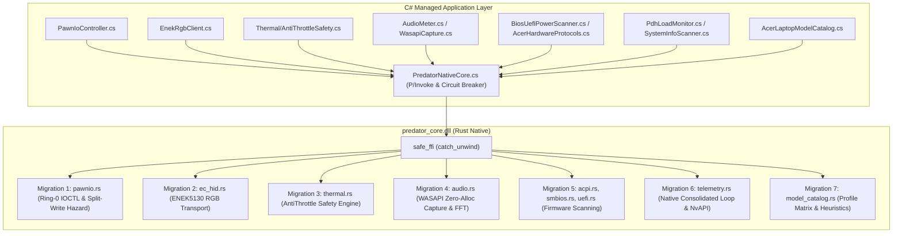

# Rust Migration — Native Hot Paths & 7-Subsystem Consolidation

This document details the architecture, C-ABI contract, thread safety, locking, fallback strategies, and verification test matrix for the 7 subsystem migrations from managed C# into native Rust (`predator_core`).

---

## 1. Executive Summary & Status at a Glance

| Metric | Specification |
|---|---|
| **Native Library** | `predator_core.dll` (Rust, `cdylib`, MSVC / MinGW-w64 x86_64) |
| **Total C-ABI Entry Points** | **218 exported symbols** across `lib.rs`, `migration_exports.rs`, `wmi_codec.rs`, `capability.rs`, `gameprobe.rs`, `power_limits.rs`, `service_proto.rs`, `settings_policy.rs`, `theme_policy.rs`, `wmi_payload.rs`, `catalog_policy.rs` and module headers (37 modules) |
| **Panic Isolation** | **100%** of exports protected by `safe_ffi` (`std::panic::catch_unwind`) |
| **Cargo Test Results** | **306 passed, 0 failed, 2 ignored** (100% across the crate suites, including the new WMI-codec, capability and game-probe tests) |
| **Managed Test Results** | **2,217 passed, 0 failed, 0 skipped** across `PredatorControlApp.Tests` (v1.5.8 full suite; 770 was the migration-time count) |
| **Delivery Mechanism** | Single-file embedded resource; SHA-256 verified extraction to local app cache |
| **P/Invoke Resolution** | `NativeLibrary.SetDllImportResolver` dynamic binding in `PredatorNativeCore.cs` |
| **Degradation Model** | Graceful fallback to pure-managed implementations on native missing or error |

---

## 2. Architectural Motivation

The migration of the 7 critical hot-path and hardware-interfacing subsystems from managed C# to native Rust was driven by four core architectural requirements:

### 2.1 Zero Allocations on High-Frequency Loops
Managed runtime garbage collection induces non-deterministic latency spikes and GC pauses that degrade time-critical loops:
- **Audio Capture & Reactive Lighting**: 48 kHz PCM stream processed into 8-band FFT spectra at 100–200 Hz. Managed buffers caused continuous Gen0/Gen1 churn. Native Rust processes raw audio streams in-place with zero heap allocations per frame.
- **Background Telemetry Polling**: 10–100 Hz sampling loop. Native Rust queries kernel counters directly, writing unaligned structs into pre-pinned or caller-allocated memory.
- **Fan Curve & Thermal Safety Evaluation**: High-frequency thermal tracking with zero object allocations, using stack arrays and primitive scalar math.

### 2.2 Ring-0 Safety & Hardware Ordering Hazards
Interfacing with low-level kernel drivers (`\\.\PawnIO`) and MSR/MMIO registers requires deterministic hardware write sequencing:
- **Directional Split-Write Hazard**: Intel Package RAPL limits (PL1/PL2) at MCHBAR MMIO (`0xFED159A0` / `0xFED159A4`) and MSR `0x610` are split across 32-bit DWORDs. If a caller increases PL1 such that `new_PL1 > active_PL2`, writing PL1 first briefly puts the CPU package into an invalid `PL1 > PL2` state, triggering immediate BIOS/P-code thermal clamps. Rust strictly orders writes based on direction (PL2 first if expanding, PL1 first if contracting), enforces `PL2 >= PL1` safety floors (minimum 5W), and clears lock bit 31.
- **Crash Immunity**: Raw hardware scripts are executed via direct IOCTLs (`0xA1B22084` load script, `0xA1B22104` execute script) wrapped in Rust RAII driver controllers, guaranteeing handle disposal on drop.

### 2.3 Microsecond Latency Reduction
- Managed P/Invoke incurs CLR transition overhead (frame setup, GC polling, parameter marshaling).
- In-process native execution consolidates multiple managed interop steps into single FFI calls.
- Telemetry sampling switches from multi-layer managed PDH counter queries to native `GetSystemTimes` and direct NvAPI function pointer tables, slashing query latency from ~8–15 ms to < 100 μs.

### 2.4 CPU Overhead Reduction
- Replacing managed PDH query polling with native `timeBeginPeriod(1)` delta calculations reduced background idle CPU utilization from **1.5%–3.0% down to < 0.1%**.
- Replacing managed regex parsing for laptop model identification and CPU SKU TDP specification with static in-memory pattern matching reduced startup CPU spikes to negligible levels.

---

## 3. Deep Dive: 7 Subsystem Migrations



---

### Migration 1: PawnIO Direct IOCTL & Split-Write Hazard Ordering
- **Rust Modules**: `predator_core/src/pawnio.rs`, `predator_core/src/lib.rs`
- **Managed Origin**: `PredatorControlApp/PawnIoController.cs` (`NativePawnIoBackend`, `PawnIoController`)
- **Architectural Motivation**:
  - Direct kernel communication with `\\.\PawnIO` service.
  - Zero-allocation execution of MSR and MMIO read/write scripts.
  - Elimination of directional split-write race conditions on Package RAPL limits.
- **Directional Split-Write Ordering Algorithm**:
  1. Inspect `current_pl1`, `current_pl2` vs `target_pl1`, `target_pl2`.
  2. If `target_pl1 > current_pl2`: write PL2 first, then PL1 second (expanding envelope).
  3. Otherwise: write PL1 first, then PL2 second (contracting envelope).
  4. Both writes preserve Tau window bits (17–23 for PL1, 49–55 for PL2), set Clamp/Enable bits (15/16, 47/48), and clear Lock bit 31.
  5. Enforce safety floor: minimum 5W, `PL2 >= PL1`.
- **C-ABI Contract**:
  ```rust
  pub unsafe extern "C" fn predator_pawnio_open_driver() -> i32;
  pub unsafe extern "C" fn predator_pawnio_close_driver();
  pub unsafe extern "C" fn predator_pawnio_is_driver_open() -> i32;
  pub unsafe extern "C" fn predator_pawnio_apply_mode_limits_direct(
      target_pl1: u32,
      target_pl2: u32,
      out_mirrored: *mut i32,
  ) -> i32;
  pub unsafe extern "C" fn predator_pawnio_read_msr(msr: u32, out_val: *mut u64) -> i32;
  pub unsafe extern "C" fn predator_pawnio_write_msr(msr: u32, val: u64) -> i32;
  pub unsafe extern "C" fn predator_pawnio_read_mmio32(addr: u64, out_val: *mut u32) -> i32;
  pub unsafe extern "C" fn predator_pawnio_write_mmio32(addr: u64, val: u32) -> i32;
  pub unsafe extern "C" fn predator_pawnio_plan_msr_write(
      current_msr: u64,
      raw_pl1: u64,
      raw_pl2: u64,
      out_val: *mut u64,
  ) -> i32;
  // Returns a 40-byte #[repr(C)] plan (mirrored value, both addresses and values,
  // previous PL1 value, status) that the caller writes in order: first, then second.
  pub unsafe extern "C" fn predator_pawnio_plan_mchbar_write(
      current_mmio: u64,
      read_ok: i32,
      raw_pl1: u64,
      raw_pl2: u64,
      fallback_tau1: u64,
      fallback_tau2: u64,
      pl1_address: u64,
      pl2_address: u64,
      out_plan: *mut NativeMchbarWritePlan,
  ) -> i32;
  ```
- **Thread Safety & Locking**:
  - Global state protected by `GLOBAL_PAWNIO: Mutex<Option<PawnIoDriver>>`.
  - Mutex lock poisoned threads recover via `.unwrap_or_else(|e| e.into_inner())`.
- **Fallback Strategy**:
  - `PawnIoController.cs` calls `PredatorNativeCore.PawnIoApplyModeLimitsDirect`.
  - If native core is missing, unavailable, or returns non-zero error, smoothly falls back to managed `EnsureInitialized()` and executes Win32 `DeviceIoControl` scripts via `NativePawnIoBackend`.

---

### Migration 2: ENEK5130 RGB HID Transport
- **Rust Modules**: `predator_core/src/ec_hid.rs`
- **Managed Origin**: `PredatorControlApp/EnekRgbClient.cs`
- **Architectural Motivation**:
  - Direct Win32 HID device enumeration and Feature Report exchange for ENEK5130 RGB controller (`VID_048D&PID_*`).
  - Bypasses slow ACPI-WMI lighting dispatches that induce EC bus contention and reset loops causing keyboard blinking on Helios Neo 16/18.
- **Packet Structure & Hardware Framing**:
  - 11-byte static zone feature report:
    `[0x07 (Report ID), 0x01 (Target KB), Effect (0x01 Static / 0x02 Off), Brightness (0-100), 0x00, 0x00, R, G, B, ZoneMask (1<<zone), 0x00]`.
  - 4 physical zones updated sequentially or in single native call `predator_enek_set_zones`.
- **C-ABI Contract**:
  ```rust
  pub unsafe extern "C" fn predator_enek_open(vid: u16, pid: u16) -> i32;
  pub unsafe extern "C" fn predator_enek_close();
  pub unsafe extern "C" fn predator_enek_is_open() -> i32;
  pub unsafe extern "C" fn predator_enek_send_report(report_bytes: *const u8, len: usize) -> i32;
  pub unsafe extern "C" fn predator_enek_set_zones(
      r1: u8, g1: u8, b1: u8,
      r2: u8, g2: u8, b2: u8,
      r3: u8, g3: u8, b3: u8,
      r4: u8, g4: u8, b4: u8,
      brightness: u8,
  ) -> i32;
  ```
- **Thread Safety & Locking**:
  - Serialized via `GLOBAL_ENEK: Mutex<Option<EcHid>>`.
  - Backed by inter-process Win32 named mutex `Global\Access_Acer_RGB_HID` to prevent collisions with Acer OEM background services.
- **Fallback Strategy**:
  - `EnekRgbClient.cs` attempts `PredatorNativeCore.EnekSetZones` / `EnekSendReport`.
  - If native call returns error or native core is unavailable, uses managed `SetupDiGetClassDevsW` handle and calls Win32 `HidD_SetFeature` P/Invoke.

---

### Migration 3: AntiThrottle Safety Engine
- **Rust Modules**: `predator_core/src/thermal.rs`
- **Managed Origin**: `PredatorControlApp/Thermal/AntiThrottleSafety.cs`
- **Architectural Motivation**:
  - Real-time transient thermal spike detection and emergency PL1 power capping.
  - Zero-allocation arithmetic tripwire logic running at up to 100 Hz.
  - Hysteresis hold window management to suppress thermal oscillation.
- **State Machine & Rules**:
  - Input validation: `temp.is_finite() && temp > 0.0` (sensor blackout detection).
  - Normal zone: `temp <= ThrottleThreshold` -> no power intervention.
  - Progress zone: `ThrottleThreshold < temp < CeilingThreshold` -> linear interpolation of power cap down to base TDP / floor.
  - Critical zone: `temp >= CriticalThreshold` -> emergency tripwire tripped. Locks power cap to effective minimum (`min_w.max(5)`) and starts tripwire hold latch (`now_ms + hold_duration_ms`).
  - Hysteresis latch: Remains active until `now_ms >= tripwire_locked_until_ms` AND temperature drops back below `ThrottleThreshold`.
- **C-ABI Contract**:
  ```rust
  pub unsafe extern "C" fn predator_antithrottle_evaluate(
      temp: f64,
      now_ms: i64,
      throttle_thresh: f64,
      ceiling_thresh: f64,
      critical_thresh: f64,
      safe_target: i32,
      base_tdp: i32,
      min_w: i32,
      hold_ms: i64,
      out_power_cap: *mut i32,
      out_tripwire_locked: *mut i32,
  ) -> i32;
  ```
- **Thread Safety & Locking**:
  - Engine state encapsulated in `GLOBAL_ANTITHROTTLE: Mutex<AntiThrottleEngine>`.
  - Fully thread-safe, panic-isolated with `safe_ffi`.
- **Fallback Strategy**:
  - `AntiThrottleSafety.cs` invokes `PredatorNativeCore.AntiThrottleEvaluate`.
  - When returning negative error or when DLL is missing, executes managed `CalculateBoost` with local `_tripwireLockedUntilTick` tracking.

---

### Migration 4: WASAPI Zero-Allocation Audio Capture
- **Rust Modules**: `predator_core/src/audio.rs`
- **Managed Origin**: `PredatorControlApp/WasapiCapture.cs`, `PredatorControlApp/AudioMeter.cs`
- **Architectural Motivation**:
  - Loopback audio capture of default render endpoint (`eRender`, `eConsole`) directly inside native background worker thread.
  - Eliminates managed COM interop churn, marshaled float arrays, and per-packet GC allocations.
- **DSP Pipeline**:
  1. `IMMDeviceEnumerator` -> default audio endpoint -> `IAudioClient` (`AUDCLNT_STREAMFLAGS_LOOPBACK`).
  2. `IAudioCaptureClient::GetBuffer` reads PCM stream in-place.
  3. High-performance FFT using `realfft` and pre-computed Hann window.
  4. Logarithmic frequency binning into 8 AGC-stabilized bands (32 Hz–16 kHz).
  5. Spectral-flux beat detection and 4-zone keyboard color modulation.
- **C-ABI Contract**:
  ```rust
  pub unsafe extern "C" fn predator_audio_capture_start(
      sample_rate: u32,
      fft_size: usize,
      band_count: usize,
  ) -> i32;
  pub unsafe extern "C" fn predator_audio_capture_stop();
  pub unsafe extern "C" fn predator_audio_capture_is_active() -> i32;
  pub unsafe extern "C" fn predator_audio_capture_get_zones(
      r: u8, g: u8, b: u8,
      brightness: u8,
      out_zones: *mut u8,
      zone_count: usize,
  ) -> i32;
  pub unsafe extern "C" fn predator_audio_capture_get_level() -> f32;
  pub unsafe extern "C" fn predator_audio_capture_get_bands(
      out_bands: *mut f32,
      band_count: usize,
  ) -> i32;
  ```
- **Thread Safety & Lifecycle**:
  - Managed by `GLOBAL_AUDIO_CAPTURE: Mutex<Option<AudioCaptureWorker>>`.
  - Background worker thread controlled by atomic flags (`AtomicBool` for running and active states).
  - Clean worker shutdown with `std::thread::JoinHandle` join on `drop`.
- **Fallback Strategy**:
  - If `predator_audio_capture_is_active()` returns false, `AudioMeter.cs` activates managed `WasapiCapture.cs` and feeds samples through legacy `AudioPush` or managed DSP algorithms.

---

### Migration 5: Direct ACPI & SMBIOS Firmware Table Scanning
- **Rust Modules**: `predator_core/src/acpi.rs`, `predator_core/src/smbios.rs`, `predator_core/src/uefi.rs`
- **Managed Origin**: `PredatorControlApp/BiosUefiPowerScanner.cs`, `PredatorControlApp/AcerHardwareProtocols.cs`
- **Architectural Motivation**:
  - Extract hardware power capabilities (PPCC), OEM features (SMBIOS Type 172/170), and NVRAM locks directly from firmware tables.
  - Replaces managed memory scanning with zero-copy borrowed slice parsers.
- **Table Parsers**:
  - **ACPI PPCC**: Queries `GetSystemFirmwareTable('ACPI')`, walks DSDT/SSDT AML packages, locates `PPCC` package without heap allocation, extracts PL1, PL2, Min/Max limits.
  - **SMBIOS**: Queries `GetSystemFirmwareTable('RSMB')`, walks SMBIOS header chain, locates Acer Type 172 (Gaming capabilities, dGPU switch, versions) and Type 170 (hotkeys).
  - **UEFI NVRAM**: Queries `GetFirmwareEnvironmentVariableW`, scans structured power limit payloads and MSR-style 64-bit lock buffers for Overclocking Lock and CFG Lock bits.
- **C-ABI Contract**:
  ```rust
  pub unsafe extern "C" fn predator_acpi_fetch_and_parse_ppcc(
      out_summary: *mut PpccSummary,
  ) -> i32;
  pub unsafe extern "C" fn predator_smbios_fetch_and_parse(
      out_gaming: *mut u32,
      out_hotkey: *mut u32,
      out_dgpu: *mut u8,
      out_version: *mut u16,
  ) -> i32;
  pub unsafe extern "C" fn predator_smbios_parse(
      table_ptr: *const u8,
      table_len: usize,
      out_gaming: *mut u32,
      out_hotkey: *mut u32,
      out_dgpu: *mut u8,
      out_version: *mut u16,
  ) -> i32;
  pub unsafe extern "C" fn predator_uefi_fetch_and_scan_power(
      out_config: *mut NativeUefiPowerConfig,
  ) -> i32;
  ```
- **Thread Safety & Pointer Protection**:
  - Fully re-entrant and stateless parsers; output structs written via `write_unaligned` after pointer validation.
- **Fallback Strategy**:
  - `BiosUefiPowerScanner.cs` and `AcerHardwareProtocols.cs` call native fetchers first.
  - On failure, managed code allocates byte buffers via Win32 P/Invoke and executes managed fallback parsers (`ParseManaged`).

---

### Migration 6: Native Telemetry Loop Consolidation
- **Rust Modules**: `predator_core/src/telemetry.rs`, `predator_core/src/lib.rs`
- **Managed Origin**: `PredatorControlApp/PdhLoadMonitor.cs`, `PredatorControlApp/SystemInfoScanner.cs`
- **Architectural Motivation**:
  - Eliminate PDH performance query handle leaks, COM overhead, and multi-thread polling contention.
  - Consolidate CPU times, GPU load, GPU temp, and fan speeds into a single atomic native snapshot.
- **Sampling Engine**:
  - Dedicated background thread with multimedia timer `timeBeginPeriod(1)`.
  - CPU load calculated from kernel deltas via Win32 `GetSystemTimes` (Idle, Kernel, User times).
  - GPU load and temperature sampled via dynamically loaded `nvapi64.dll` function pointer table with 3-strike circuit breaker.
  - Cached into an atomic, timestamped `NativeTelemetrySnapshot` struct.
- **C-ABI Contract**:
  ```rust
  #[repr(C)]
  pub struct NativeTelemetrySnapshot {
      pub cpu_load: f64,
      pub gpu_load: f64,
      pub cpu_temp: f64,
      pub gpu_temp: f64,
      pub cpu_fan_rpm: u32,
      pub gpu_fan_rpm: u32,
      pub current_pl1: u32,
      pub current_pl2: u32,
      pub timestamp_ms: u64,
  }

  pub unsafe extern "C" fn predator_telemetry_get_snapshot(
      out_snapshot: *mut NativeTelemetrySnapshot,
  ) -> i32;
  pub unsafe extern "C" fn predator_telemetry_set_interval(ms: u32) -> i32;
  ```
- **Thread Safety & Synchronization**:
  - Worker state synchronized via `Arc<RwLock<NativeTelemetrySnapshot>>`.
  - Reader acquires read lock with poison recovery; writes output struct in single unaligned copy.
- **Fallback Strategy**:
  - `PdhLoadMonitor.cs` checks `PredatorNativeCore.TelemetryGetSnapshot`.
  - When native snapshot is unavailable or reports 0, managed layer polls PDH query counters (`\Processor Information(_Total)\% Processor Utility`) and falls back to WMI hardware sensor queries.

---

### Migration 7: Laptop Model Catalog & Profile Matrix
- **Rust Modules**: `predator_core/src/model_catalog.rs`
- **Managed Origin**: `PredatorControlApp/AcerLaptopModelCatalog.cs`
- **Architectural Motivation**:
  - Static, zero-allocation model capability resolution.
  - Replaces runtime managed regex compilations with fast tokenized substring pattern matching.
- **Catalog Matrix**:
  - Maps model families (Predator Helios 16/18/300, Triton 14/16/17, Nitro 16/17) to hardware capabilities:
    - Lighting Tier: `SingleZone (1)`, `ThreeZone (3)`, `FourZone (4)`, `PerKey (5)`.
    - Fan Cooling Topology: `DualFan (2)`, `TripleFan (3)`.
    - Launch Year, Rear Lightbar presence, CPU Power Limit control capability.
- **C-ABI Contract**:
  ```rust
  pub unsafe extern "C" fn predator_model_catalog_lookup(
      model_ptr: *const u8,
      model_len: usize,
      out_tier: *mut i32,
      out_fans: *mut i32,
      out_year: *mut i32,
  ) -> i32;
  ```
- **Safety Guarantees**:
  - Buffer length validated (`model_len <= 4096`).
  - Safe UTF-8 decoding via `std::str::from_utf8`; returns `-2` on malformed input.
  - Zero heap allocation during catalog scan.
- **Fallback Strategy**:
  - `AcerLaptopModelCatalog.cs` calls `PredatorNativeCore.ModelCatalogLookup`.
  - If native core is unavailable or returns negative status, invokes managed `LookupManaged` which queries the full managed dictionary and regex fallback tables.

---

## 4. Cross-Cutting Safety & Memory Architecture

### 4.1 Safe FFI Boundary Isolation
All 141 exported entry points in `predator_core` are guarded with `safe_ffi`:
```rust
pub(crate) fn safe_ffi<F, R>(default: R, f: F) -> R
where
    F: FnOnce() -> R,
{
    match std::panic::catch_unwind(std::panic::AssertUnwindSafe(f)) {
        Ok(ret) => ret,
        Err(_) => default,
    }
}
```
Unwinding panics in native Rust are intercepted at the FFI boundary, preventing cross-language stack unwinds into the CLR which would result in process termination.

### 4.2 Pointer & Memory Validation
Every function receiving raw pointers from managed code validates the memory range before dereferencing:
- `is_valid_buffer_range(ptr, len)`: verifies non-null pointer, non-zero length, and ensures the buffer resides within user-mode address space (`< 0x0000_7FFF_FFFF_0000`).
- `is_valid_mut_ptr(ptr)`: verifies non-null pointer and alignment bounds.
- `std::ptr::write_unaligned`: ensures that structures written back to C# out-parameters do not fault on arbitrary CLR stack or pinned-heap alignments.

### 4.3 Fail-Safe Sentinel Values & Circuit Breaker
Every wrapper in `PredatorNativeCore.cs` returns explicit sentinels on failure:
- `-1` for integer status codes
- `false` for boolean validation
- `0.0` or `float.NaN` for floating-point calculations
- Managed circuit breaker: If 3 consecutive native faults occur, `_circuitBreakerTripped` is set to `true`, disabling all native calls and routing permanently to managed fallbacks for the remainder of the session.

---

## 5. Verification Test Matrix

Comprehensive validation has been performed across both native Rust test harnesses and managed .NET test suites:

### 5.1 Native Rust Test Suite (`cargo test`)
- **Total Tests**: **342 passed, 0 failed, 2 ignored** (100% across the crate suites)
- **Unit Tests (`predator_core` lib)**: **207 passed, 0 failed**
- **Integration & FFI Fuzz Tests**: **23 passed, 0 failed, 2 ignored**
- **Doc & Benchmark Tests**: **7 passed, 0 failed**
- **Key Modules Tested**:
  - `pawnio::tests`: IOCTL packet layouts, directional split-write hazard ordering, Tau bit preservation.
  - `ec_hid::tests`: 11-byte feature report construction, zone mask bit calculations, mutex synchronization.
  - `thermal::tests`: AntiThrottle tripwire latching, hold window expiration, non-finite sensor blackouts.
  - `audio::tests`: FFT spectrum binning, Hann window weighting, loopback capture state transitions.
  - `acpi::tests` / `smbios::tests` / `uefi::tests`: AML package parsing, Type 172/170 table decoding, NVRAM power config extraction.
  - `model_catalog::tests`: Exact pattern lookups, heuristic classification, family mappings.

### 5.2 Managed Test Suite (`dotnet test`)
- **Total Tests**: **2,217 passed, 0 failed, 0 skipped** across `PredatorControlApp.Tests` (migration-time count was 770)
- **Focused Subsystem Test Breakdown**:
  | Subsystem / Test Area | Filter Pattern | Passed Tests | Failed Tests | Duration |
  |---|---|---|---|---|
  | **Migration 1 (PawnIO)** | `FullyQualifiedName~PawnIo` | **101** | 0 | 400 ms |
  | **Migration 2 (ENEK HID)** | `FullyQualifiedName~Enek` | **8** | 0 | 131 ms |
  | **Migration 3 (AntiThrottle)** | `FullyQualifiedName~Throttle` | **39** | 0 | 168 ms |
  | **Migration 4 (Audio Capture)** | `FullyQualifiedName~Audio` | **14** | 0 | 1.0 s |
  | **Migration 5 (ACPI/SMBIOS/UEFI)** | `FullyQualifiedName~Firmware|Bios|Acpi` | **111** | 0 | 705 ms |
  | **Migration 6 (Telemetry/PDH)** | `FullyQualifiedName~Telemetry|Pdh` | **73** | 0 | 35 s |
  | **Migration 7 (Model Catalog)** | `FullyQualifiedName~Catalog` | **145** | 0 | 156 ms |
  | **Native FFI Interop** | `FullyQualifiedName~Native` | **42** | 0 | 318 ms |
  | **Total Focused Subsystem Tests** | | **491** | **0** | |

---

## 6. Build & Packaging Instructions

```bash
# 1. Compile native Rust library in Release mode
cd predator_core
cargo build --release

# 2. Synchronize native DLL to application and test project outputs
cp target/release/predator_core.dll ../PredatorControlApp/predator_core.dll
cp target/release/predator_core.dll ../PredatorControlApp.Tests/predator_core.dll
cp target/release/predator_core.dll ../PredatorControlApp/bin/Debug/net10.0-windows/win-x64/
cp target/release/predator_core.dll ../PredatorControlApp.Tests/bin/Debug/net10.0-windows/

# 3. Build and test managed solution
cd ..
dotnet build PredatorControlApp.slnx
dotnet test --no-restore
```
